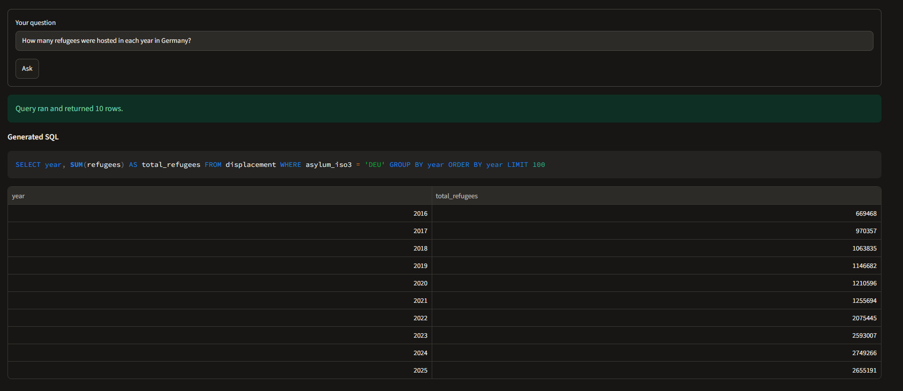
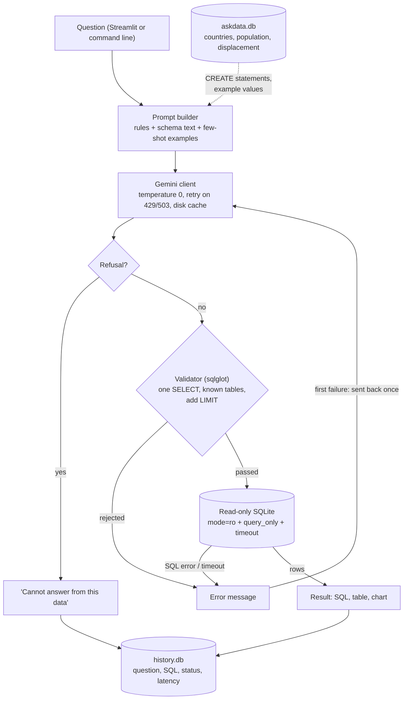

# Ask the Data

**Ask questions about refugee and population statistics in plain English. The app writes the SQL, checks it, runs it read-only on SQLite, and shows the result. Its accuracy is measured on a hand-written evaluation set.**


**Live demo:** <https://askthedata-7yzqp8czec74htrvnalurx.streamlit.app/>

[](https://github.com/backpropy-hit/AskTheData/actions/workflows/ci.yml)

## The problem

Nonprofit staff often have their numbers in databases but cannot write SQL. A natural-language interface helps, but generated SQL can be wrong or unsafe, and most demos never say how often it is right. This project generates SQL from a question, checks the query before running it on a read-only connection, and **measures** how often the answer is correct.

## Architecture



Each box is one module in `src/askdata/`. The Streamlit app (`app/streamlit_app.py`) only handles layout.

## Results

> **[PLACEHOLDER: no evaluation has been run yet.]** Fill this section from the latest files in `eval/results/` with `python -m askdata.evaluation.report`, which prints these tables from the newest `*_summary.csv`. Do not type numbers by hand.

**Model:** [MODEL FROM RESULTS FILE] · **Run date:** [RUN DATE FROM RESULTS FILE] · **Questions:** [N] hand-written questions in `eval/questions.jsonl`

Execution accuracy (passed / questions):

| Strategy | All | Easy | Medium | Hard | Unanswerable | Validator rejections | Median latency (s) |
| --- | --- | --- | --- | --- | --- | --- | --- |
| zero_shot | [X] | [X] | [X] | [X] | [X] | [X] | [X] |
| few_shot | [X] | [X] | [X] | [X] | [X] | [X] | [X] |
| few_shot_retry | [X] | [X] | [X] | [X] | [X] | [X] | [X] |

[PLACEHOLDER: one or two sentences on what the numbers show, including whether the retry helped. Report it even if it did not.]

### Failure types

> **[TO COMPLETE BY HAND]** After a run, open the results CSV, put one type in the `failure_type` column of every failed row, then run `python -m askdata.evaluation.report` again to count them.

| Failure type | Count | Example (question id, what went wrong) |
| --- | --- | --- |
| Wrong column | [X] | [EXAMPLE] |
| Wrong join | [X] | [EXAMPLE] |
| Wrong filter value | [X] | [EXAMPLE] |
| Wrong aggregation | [X] | [EXAMPLE] |
| Refused an answerable question / answered an unanswerable one | [X] | [EXAMPLE] |
| Other | [X] | [EXAMPLE] |

## Quickstart

Requires Python 3.11 or newer and a Gemini API key.

```bash
python -m venv .venv
# Windows: .venv\Scripts\activate      macOS/Linux: source .venv/bin/activate
pip install -e ".[dev]"
cp .env.example .env                  # then put your Gemini key in .env

python -m askdata.db.download         # fetch the CSVs into data/raw/ (not committed)
python -m askdata.db.loader           # build data/askdata.db
streamlit run app/streamlit_app.py    # open the app
```

Other commands (each also has a `make` target):

```bash
python -m askdata.nl2sql.pipeline "Which 5 countries hosted the most asylum-seekers in 2024?"
python -m askdata.evaluation.run_eval      # run all three strategies (needs eval/questions.jsonl)
python -m askdata.evaluation.report        # print README tables from the latest run
pytest                                     # tests: no API key or data needed
ruff check . && ruff format --check .
```

### Checking the model name

The model id is set in `configs/config.yaml` (`model.name`). Model availability changes over time: during development `gemini-2.5-flash` was listed for the key but returned "no longer available to new users", so the project uses `gemini-3.5-flash`. To list the models your key can see:

```python
from dotenv import load_dotenv
from google import genai

load_dotenv()  # copies GEMINI_API_KEY from .env into the environment
client = genai.Client()  # reads GEMINI_API_KEY from the environment
for model in client.models.list():
    print(model.name)
```

A listed model can still be unavailable, so try one question with `python -m askdata.nl2sql.pipeline` after changing it.

## Deploying on Streamlit Community Cloud

1. Push the repository to GitHub. Neither the data nor the database is in the repository.
2. On Streamlit Community Cloud, create a new app from the repository:
   - branch: `main`
   - main file path: `app/streamlit_app.py`
   - Python version: 3.11 or newer (advanced settings)
3. In the app's **Secrets**, add your key:

   ```toml
   GEMINI_API_KEY = "your-key-here"
   ```

4. Deploy. `requirements.txt` installs the package. On the first start the app downloads the CSVs from the UNHCR and World Bank APIs and builds `data/askdata.db` once, so the first page load is slower.

The public app uses **your** API key for every visitor:

- Use a key without billing enabled, so heavy use can only exhaust the free quota and never produces a bill.
- Each browser session can ask at most `app.max_questions_per_session` questions (`configs/config.yaml`). This only slows down casual misuse; reloading the page starts a new session.
- The history panel shows each visitor only their own questions.
- The history file lives on the app's temporary disk and is lost when the app restarts.

## Data

| Table | Source | Licence |
| --- | --- | --- |
| `displacement`: refugees, asylum-seekers, IDPs, stateless people and others, by year, origin country and asylum country (2016 to 2025) | UNHCR Refugee Data Finder (population statistics API) | No explicit licence found; raw files are **not** redistributed here |
| `population`: total population by country and year | World Bank, World Development Indicators (SP.POP.TOTL) | CC BY 4.0 |
| `countries`: name, World Bank region and income group | World Bank country metadata (same download) | CC BY 4.0 |

All three tables join on a three-letter country code. `displacement` has two country columns (origin and asylum), so some questions need the `countries` table joined twice. Download URLs, dates, checksums and the licence check are in [`data/sources.md`](data/sources.md).

Loading choices:

- World Bank aggregates such as "World" are dropped so sums do not double-count.
- UNHCR-only codes (e.g. `XXA` stateless, `UNK` unknown) are kept as countries with no region.
- Population is kept only for the years the displacement data covers.
- One almost-empty UNHCR column is left out.

## Design decisions

- **What the prompt contains.** The real `CREATE TABLE` statements (read from the database, so they cannot drift), a one-line description of every column, all values of the categorical columns (regions, income groups), and examples of country names the World Bank spells unusually (e.g. `'Iran, Islamic Rep.'`, `'Türkiye'`). Without these, models guess filter values wrong. A test fails if a column has no description.
- **Few-shot examples and evaluation leakage.** The few-shot prompt has 5 examples: a lookup, an aggregate, one join, the double join, and a refusal. They were written to differ from the evaluation questions and from the example questions in the project proposal. `tests/test_prompts.py` fails if any few-shot question **or** SQL matches an evaluation question or gold query, comparing case- and punctuation-insensitively. The evaluation questions and gold SQL were written separately, by hand.
- **Two safety layers.**
  - The validator (`safety/validator.py`, sqlglot) accepts exactly one `SELECT` (WITH and UNION allowed) over the three known tables. It rejects DDL, DML, `PRAGMA`, `ATTACH`, unparseable commands, table functions such as `pragma_table_info()`, database prefixes and `load_extension`, and adds a `LIMIT` when missing.
  - The database is then opened with SQLite URI `mode=ro` plus `PRAGMA query_only`, so a validator bug still cannot write.
  - Queries are cancelled after a time limit.
- **One correction.** If the validator rejects the query, or SQLite reports an error or timeout, the error message is sent back to the model once. Temporary API errors (429 rate limit, 503 high demand) are retried separately, with growing waits, and never count as a correction.
- **Unanswerable questions.** The prompt asks for one fixed reply, `CANNOT ANSWER: cannot answer from this data`, which the pipeline detects. A refusal is scored as correct only for questions marked unanswerable.
- **Execution accuracy.**
  - A generated query is correct if it returns the same rows as the gold query: compared as sets of tuples, or in order when the gold query's outermost `SELECT` has `ORDER BY`.
  - Numbers are rounded to 2 decimals, and column names are ignored.
- **Repeatable runs.**
  - Temperature 0, and every results file records the model name and run date.
  - Replies are cached on disk, keyed by model, temperature and the exact prompt.
  - `few_shot` and `few_shot_retry` share the same first prompt, so the retry strategy reuses the few-shot first answer and differs **only** by the retry.
  - Latency is reported only for answers that made a real model call.
- **Thin UI.** All logic lives in the `askdata` package. The Streamlit file only lays out the page, so the logic is tested without a browser. The app script itself is also tested with Streamlit's `AppTest` and a fake model.

## Project structure

```text
configs/config.yaml          model name, paths, row limit, timeout, retries
data/sources.md              sources, licences, download URLs, checksums
src/askdata/
  config.py                  typed config loader
  db/download.py             fetch raw CSVs
  db/loader.py               CSVs -> SQLite tables, keys, indexes
  db/connection.py           read-only connection, query timeout
  db/schema_text.py          schema description for the prompt
  llm/client.py              Gemini wrapper: retries, cache
  llm/prompts.py             rules, few-shot examples, retry prompt
  nl2sql/generate.py         model reply -> SQL or refusal
  nl2sql/pipeline.py         generate -> validate -> run -> retry once
  safety/validator.py        sqlglot checks, LIMIT
  history.py                 query log in a separate SQLite file
  display.py                 chart choice and user messages
  evaluation/metrics.py      execution accuracy
  evaluation/run_eval.py     runs all strategies, writes eval/results/
  evaluation/report.py       README tables from the latest run
app/streamlit_app.py         user interface (layout only)
eval/questions.jsonl         evaluation questions + gold SQL (hand-written)
eval/results/                one CSV + one summary CSV per run
tests/                       pytest suite (fake data, fake model)
```

## Limitations

- **Small evaluation set.** The questions were written by one person, and a small set gives a rough estimate only.
- **Model versions change.** Outputs vary between model versions, and models get retired. The model and run date are recorded with every result.
- **One database.** Results may not transfer to other schemas or larger databases.
- **The validator is not a guarantee.** It reduces risk; the read-only connection is the second layer.
- **The metric can be fooled or be too strict:**
  - A wrong query can pass if it happens to return the same rows.
  - Column order matters: `(name, total)` does not match `(total, name)`.
  - An extra column counts as wrong.
  - Duplicate rows are ignored because rows are compared as sets.
- **Row limit.** Queries without their own `LIMIT` are capped at the configured row limit (100), so a gold result larger than that cannot be matched. `run_eval` warns about such gold queries.
- **Latency is noisy.** API response times vary a lot between calls, so medians are reported alongside means.
- **Temporary API failures.** A 503 or 429 that persists through all retries is scored as a failure (`llm_error`). These answers are visible in the results CSV.
- **Small-scale app.** The Streamlit app shares one read-only database connection between visitors and limits questions per session. It is a demo, not built for heavy traffic.
- **UNHCR licence.** No explicit licence was found for the UNHCR data, so the raw files are not included. They are downloaded with `python -m askdata.db.download`.

## License

Code: MIT (see [`LICENSE`](LICENSE)). Data: see the table above and [`data/sources.md`](data/sources.md).
