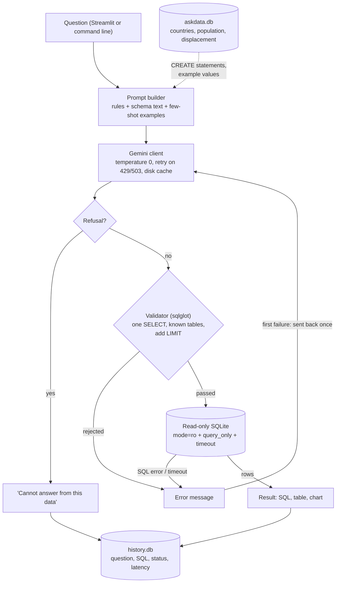

# Ask the Data

**Ask questions about refugee and population statistics in plain English. The app writes the SQL, checks it, runs it read-only on SQLite, and shows the result. Its accuracy is measured on a hand-written evaluation set.**


**Live demo:** <https://askthedata-7yzqp8czec74htrvnalurx.streamlit.app/>

[](https://github.com/backpropy-hit/AskTheData/actions/workflows/ci.yml)

## The problem

Nonprofit staff often have their numbers in databases but cannot write SQL. A natural-language interface helps, but generated SQL can be wrong or unsafe, and most demos never say how often it is right. This project generates SQL from a question, checks the query before running it on a read-only connection, and **measures** how often the answer is correct.

## Architecture



Each box is one module in `src/askdata/`. The Streamlit app (`app/streamlit_app.py`) only handles layout.

## Project structure

```text
configs/config.yaml          model name, paths, row limit, timeout, retries
data/sources.md              sources, licences, download URLs, checksums
src/askdata/
  config.py                  typed config loader
  db/download.py             fetch raw CSVs
  db/loader.py               CSVs -> SQLite tables, keys, indexes
  db/connection.py           read-only connection, query timeout
  db/schema_text.py          schema description for the prompt
  llm/client.py              Gemini wrapper: retries, cache
  llm/prompts.py             rules, few-shot examples, retry prompt
  nl2sql/generate.py         model reply -> SQL or refusal
  nl2sql/pipeline.py         generate -> validate -> run -> retry once
  safety/validator.py        sqlglot checks, LIMIT
  history.py                 query log in a separate SQLite file
  display.py                 chart choice and user messages
  evaluation/metrics.py      execution accuracy
  evaluation/run_eval.py     runs all strategies, writes eval/results/
  evaluation/report.py       README tables from the latest run
app/streamlit_app.py         user interface (layout only)
eval/questions.jsonl         evaluation questions + gold SQL (hand-written)
eval/results/                one CSV + one summary CSV per run
tests/                       pytest suite (fake data, fake model)
```

## Limitations

- **Small evaluation set.** The questions were written by one person, and a small set gives a rough estimate only.
- **Model versions change.** Outputs vary between model versions, and models get retired. The model and run date are recorded with every result.
- **One database.** Results may not transfer to other schemas or larger databases.
- **The validator is not a guarantee.** It reduces risk; the read-only connection is the second layer.
- **The metric can be fooled or be too strict:**
  - A wrong query can pass if it happens to return the same rows.
  - Column order matters: `(name, total)` does not match `(total, name)`.
  - An extra column counts as wrong.
  - Duplicate rows are ignored because rows are compared as sets.
- **Row limit.** Queries without their own `LIMIT` are capped at the configured row limit (100), so a gold result larger than that cannot be matched. `run_eval` warns about such gold queries.
- **Latency is noisy.** API response times vary a lot between calls, so medians are reported alongside means.
- **Temporary API failures.** A 503 or 429 that persists through all retries is scored as a failure (`llm_error`). These answers are visible in the results CSV.
- **Small-scale app.** The Streamlit app shares one read-only database connection between visitors and limits questions per session. It is a demo, not built for heavy traffic.
- **UNHCR licence.** No explicit licence was found for the UNHCR data, so the raw files are not included. They are downloaded with `python -m askdata.db.download`.

## License

Code: MIT (see [`LICENSE`](LICENSE)). Data: see the table above and [`data/sources.md`](data/sources.md).
